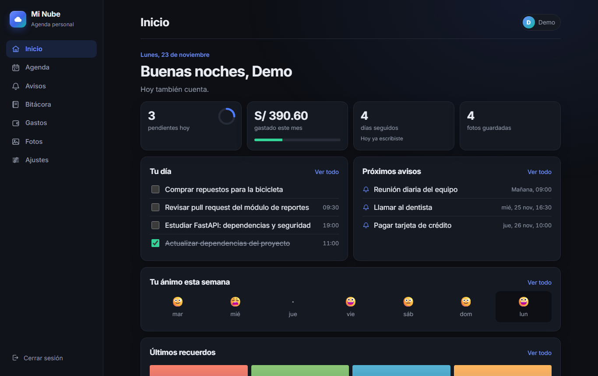
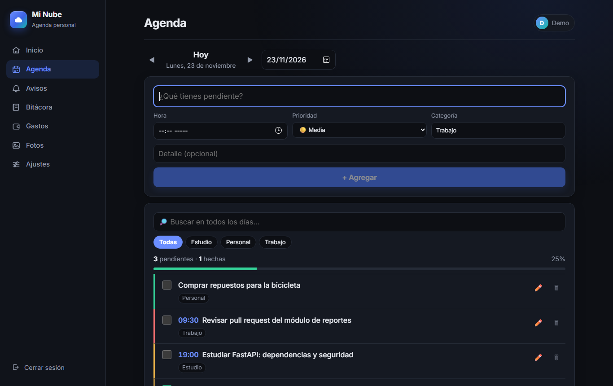
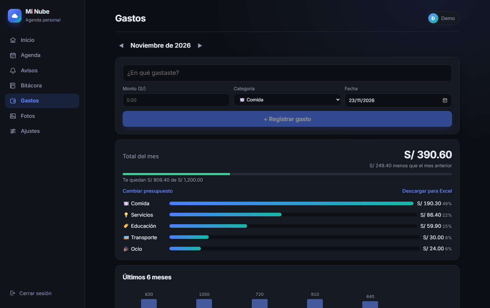
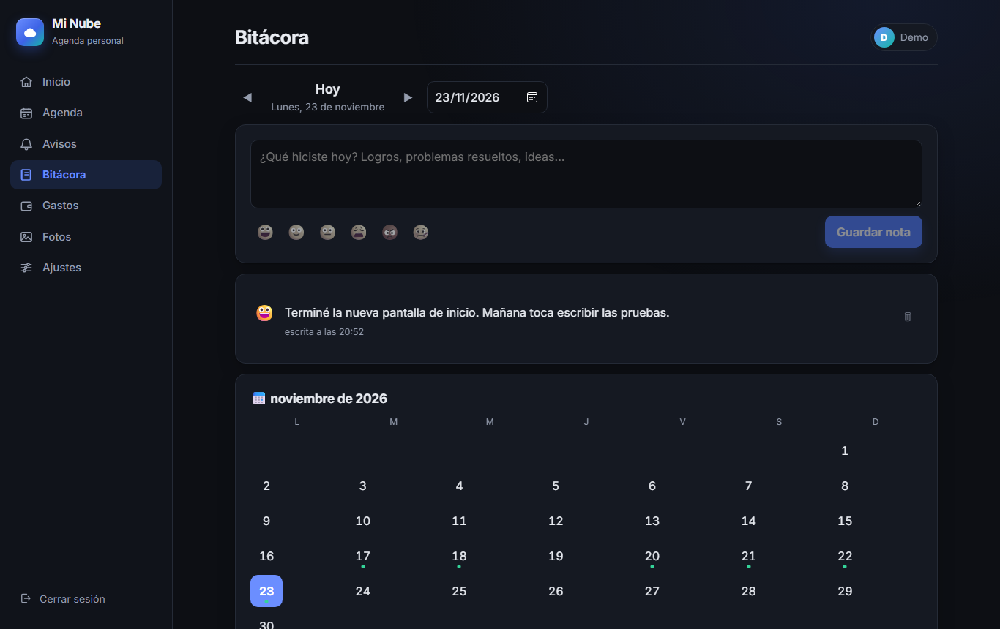
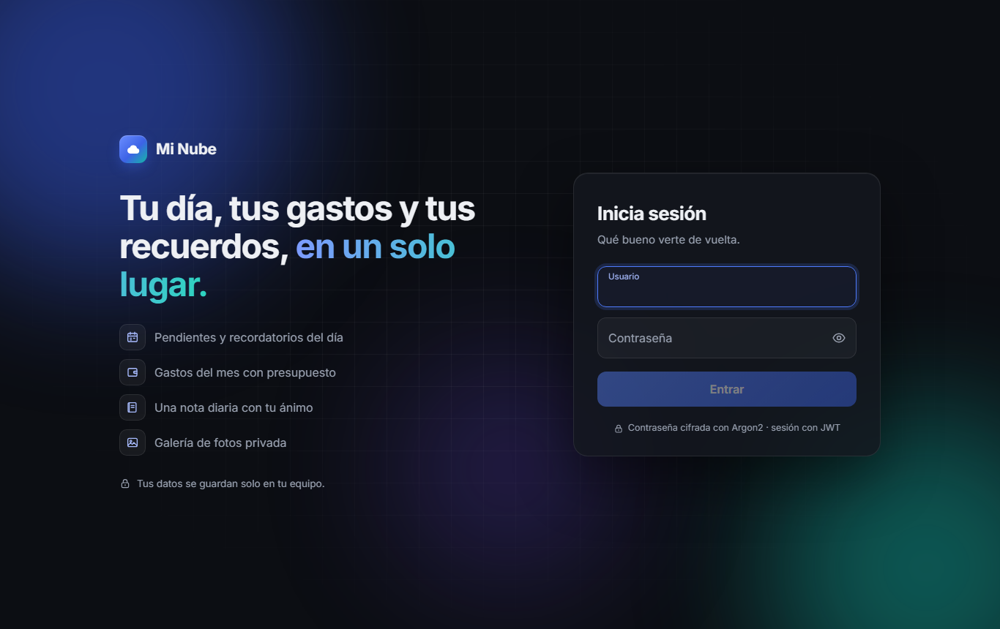

# Mi Nube

Agenda personal full stack: pendientes, recordatorios, bitácora diaria, control de gastos con presupuesto y galería de fotos privada.
Backend en **Python con FastAPI** y frontend en **React**, con inicio de sesión seguro y pruebas automáticas.



> Las capturas usan datos de demostración ficticios.

## Funcionalidades

- **Panel de inicio:** resumen del día con pendientes, gasto del mes, racha de la bitácora y próximos avisos.
- **Agenda:** crear, editar, buscar y filtrar pendientes por fecha, prioridad y categoría.
- **Recordatorios:** avisos únicos o repetitivos, con opción de posponer o completar.
- **Bitácora:** una nota por día con estado de ánimo.
- **Gastos:** registro por categoría, resumen mensual, presupuesto, tendencia de 6 meses y exportación a CSV para Excel.
- **Fotos:** subida, validación de imágenes, miniaturas, álbumes y favoritas. Las imágenes solo se entregan a usuarios autenticados.
- **Ajustes:** cambio de contraseña y copia de seguridad de la base de datos.
- **Diseño propio** moderno y neutro: tema oscuro (grafito con acentos azules) y tema claro, íconos SVG propios y vista adaptada al celular.

## Tecnologías

| Capa | Herramientas |
|---|---|
| Backend | Python 3.13, FastAPI, SQLModel (ORM), SQLite, Pillow |
| Seguridad | Tokens JWT, contraseñas con Argon2, límite de intentos de inicio de sesión, rutas protegidas |
| Frontend | React 19, Vite, JavaScript, CSS propio sin frameworks |
| Pruebas | pytest: 59 pruebas de la API (autenticación, pendientes, gastos, fotos, recordatorios y respaldos) |
| Despliegue | Dockerfile en dos etapas, docker-compose y Caddy para HTTPS (configuración incluida) |

## Arquitectura

```
Navegador ──HTTP/JSON──► FastAPI ──► SQLite
  React                    │
                           └──► carpeta de fotos
```

El frontend solo muestra la información; el backend valida, aplica las reglas y guarda los datos.
Cada módulo de la API vive en su propio archivo dentro de `backend/app/routers/`.

```
backend/
  app/
    main.py            # crea la aplicación y registra los módulos
    models.py          # tablas y esquemas de validación
    seguridad.py       # JWT, hash de contraseñas y usuario actual
    routers/           # auth, tareas, recordatorios, bitacora, gastos, fotos, inicio, sistema
  tests/               # pruebas de la API con pytest
frontend/
  src/
    vistas/            # una vista por sección (Inicio, Agenda, Gastos...)
    components/        # piezas reutilizables (formularios, tarjetas, login)
```

## Cómo ejecutarlo

Requisitos: Python 3.12 o superior y Node.js 20 o superior.

**Backend**

```bash
cd backend
python -m venv .venv
.venv/Scripts/activate        # en Linux o macOS: source .venv/bin/activate
pip install -r requirements.txt
fastapi dev app/main.py
```

La API queda en `http://127.0.0.1:8000` y su documentación interactiva en `http://127.0.0.1:8000/docs`.

**Frontend** (en otra terminal)

```bash
cd frontend
npm install
npm run dev
```

Abre `http://localhost:5173`. La primera vez la aplicación pide crear la cuenta.

**Pruebas**

```bash
cd backend
pytest
```

Las pruebas usan una carpeta de datos temporal, así que no tocan la base de datos real.

## Más capturas

| Agenda | Gastos |
|---|---|
|  |  |

| Bitácora | Inicio de sesión |
|---|---|
|  |  |

## Lo que aprendí

- Diseñar una API REST por módulos con FastAPI, validación con modelos y dependencias para proteger rutas.
- Autenticación con JWT y almacenamiento seguro de contraseñas con Argon2.
- Manejo de archivos subidos: validación, miniaturas y entrega solo a usuarios autenticados.
- Construir una interfaz en React con estado, efectos y llamadas a la API.
- Escribir pruebas automáticas que no dependan de los datos reales.
